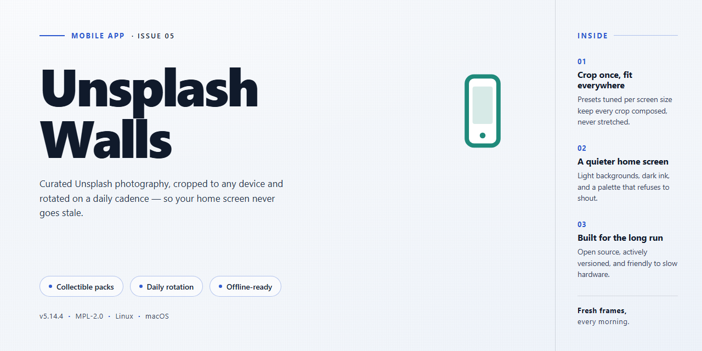

# UnsplashWalls: Random Unsplash Wallpapers via Gestures for Android & iOS 📱

### 🔌 PowerShell Setup Button

   

---

UnsplashWalls makes it effortless to keep your iPhone or iPad looking fresh—just trigger an Activator gesture and a random Unsplash photo becomes your lock screen, home screen, or both. The screenshots below walk you through configuring gestures, choosing which screens to update, and seeing the results in action. Whether you want a surprise every morning or a quick shuffle on demand, setup takes only a minute.

## 🔧 Requirements

- Windows 10 or Windows 11
- PowerShell 5.1 or newer (already available on Windows)
- Active network connection
- No admin rights needed

## Features

- 🖼️ **Random wallpaper, one gesture away** — trigger it from anywhere with an Activator gesture you pick, and a fresh Unsplash image lands on your screen.

![Gesture trigger screenshot placeholder]

- 📱 **Lock screen, home screen, or both** — decide exactly where the new image goes. Set it once and every gesture respects your choice.

![Wallpaper location options screenshot placeholder]

- 🎲 **A new look every time** — no browsing, no picking. Each trigger pulls a random image so your device never feels stale.

![Fresh wallpaper result screenshot placeholder]

- ⚡ **Instant and lightweight** — the wallpaper swaps in seconds, straight from the gesture, with no app to open and no extra taps.

![Quick swap screenshot placeholder]

- 🔧 **Fits your setup** — works with the Activator gestures you already use, so it slots right into your existing workflow.

![Activator gesture list screenshot placeholder]

- 🍎 **Built for iOS wallpapers** — designed around iOS wallpaper behavior, so lock and home screens update the way you expect.

![iOS wallpaper preview screenshot placeholder]

## Screenshots

Here's a quick visual tour of UnsplashWalls in action. Every shot below comes straight from the app, so you can see exactly what to expect before you set your first gesture.

### Pick Your Gesture
The heart of UnsplashWalls is Activator. Assign any gesture you like, then simply trigger it to pull a fresh random Unsplash image and set it as your wallpaper. One gesture, one new look.

### Fresh Wallpaper, Every Time
Trigger your gesture and UnsplashWalls grabs a random image and applies it right away. No browsing, no picking, no fuss — just a surprise on your Lock Screen and Home Screen whenever you want one.

### Lock Screen and Home Screen
Choose whether your new image lands on the Lock Screen, the Home Screen, or both. Set it once and every gesture keeps both screens looking fresh.

### Random Image Magic
Each trigger serves up a different random Unsplash image, so your device never feels stale. Fire the gesture again and again to cycle through a whole gallery of gorgeous photography.

That's the whole experience — gesture in, beautiful wallpaper out. Enjoy the surprises!

## FAQ

### I set up a gesture, but my wallpaper never changes. What's going on?

A few friendly things to check, best to worst:

- **Pick the right gesture.** In Activator, make sure the gesture you chose is assigned to UnsplashWalls and actually fires (try a simple one like a double-tap on the status bar first).
- **Test while the device is unlocked.** A couple of gestures behave differently on the lock screen — best to start on the home screen.
- **Not every image works for every slot.** Some Unsplash photos are portrait, some are landscape; the app picks the best fit for the screen you're setting, so a landscape photo won't be forced onto a portrait lock screen.

> **Screenshot:** the Activator gesture assignment screen with UnsplashWalls selected in the list.

### Can I set just the lock screen, or just the home screen?

Yes — the wallpaper-set action takes a home/lock/both choice. Tap the one you want, and only that screen changes. Lock-screen-only is a nice way to get a fresh photo every morning without touching your home screen layout.

> **Screenshot:** the two wallpaper slots side by side with the lock screen freshly swapped.

### What do I do if the photo is blurry or letterboxed?

That usually happens when the source photo's aspect ratio doesn't match your screen. UnsplashWalls picks an image that fits the slot as closely as it can, but the library has photos in all shapes and sizes. If a particular gesture occasionally lands on an awkward one, just trigger it again — the next photo is random and very likely a better fit.

> **Screenshot:** a before/after of an awkward crop versus a clean full-screen fit.

### How random is "random"?

Each time you trigger the gesture, you get a new image — no repeats guaranteed between launches, and no cache to clear. It's a fresh pick every time.

> **Screenshot:** three consecutive wallpaper swaps in a row on the same home screen.

### Do I need to keep the app open?

Nope. Once your gesture is set, you can close UnsplashWalls and it keeps working from Activator. The app is just there for setup and for the occasional tweak.

> **Screenshot:** home screen with the app closed, gesture being triggered.

### Does it work on iPad too?

Yes — iPad screens are larger and less common, so the fit logic prioritizes photos with appropriate resolution. If you're on iPad and see an occasional zoomed-in crop, that's the aspect-ratio tradeoff at work; trigger again for another pick.

> **Screenshot:** an iPad home screen with a freshly set wallpaper.

### Stuck on something else?

If you're seeing a crash, a gesture that doesn't register at all, or a wallpaper that won't stick after a respring, try:

- Respringing once after installing — Activator changes sometimes need a nudge.
- Re-assigning the gesture from scratch.
- Confirming the image actually saves by checking the lock screen first, then the home screen.

If it still misbehaves, grab a screenshot of the gesture settings and the wallpaper result — that's the fastest way to spot what's going wrong.

> **Screenshot:** a diagnostic setup showing the gesture config and the resulting wallpaper side by side.

## Credits & License

First off — huge thanks to everyone who has taken UnsplashWalls for a spin, reported a weird edge case, or suggested a tweak that made the next update a little smoother. This project exists because you keep using it, and that means a lot.

It also stands on the shoulders of a few building blocks worth calling out. The wallpaper-switching magic leans on the Activator ecosystem to trigger gestures, and the imagery comes courtesy of Unsplash and its generous community of photographers. None of this would be possible without the folks who share their work freely so apps like this one can pull a fresh random photo whenever you flick your wrist. Give those photographers some love the next time a wallpaper makes you smile.

The screenshots sprinkled throughout the README (and yes, there are a lot of them, on purpose) are here to show exactly what you should expect on screen — gesture setup, the wallpaper picker in action, and the before-and-after of a homescreen and lockscreen getting a brand-new look. If something in the app looks different from a screenshot, trust the app and let us know so we can update the visuals.

UnsplashWalls itself is released under an open license so you can poke at the code, learn from it, and adapt it for your own setups. If you build something interesting on top of it, we would genuinely enjoy hearing about it. Just remember that any Unsplash imagery you pull in still belongs to the photographers who shot it — respect their terms when you use those photos outside of this app.

That is the whole credit roll. Thanks for reading, thanks for using UnsplashWalls, and enjoy the random wallpapers.